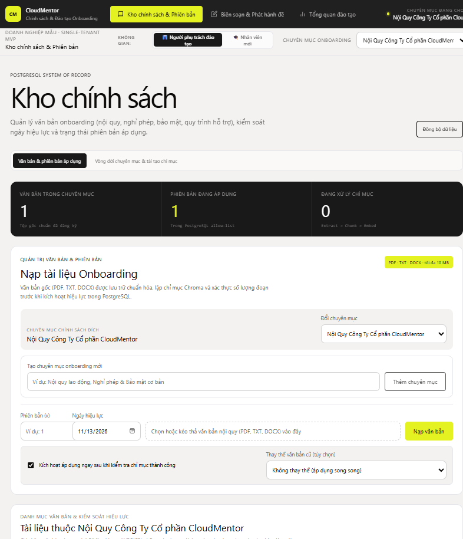
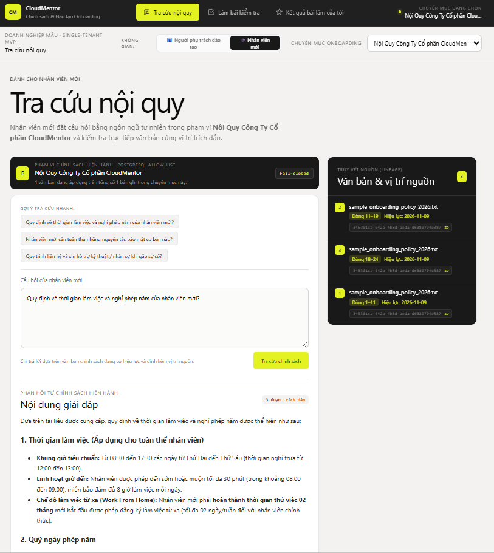
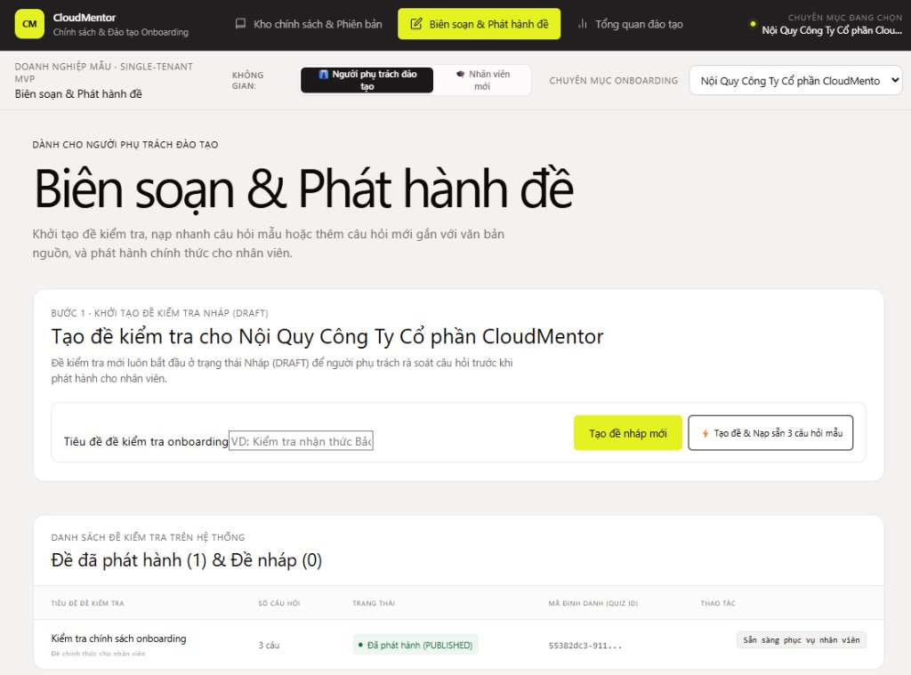
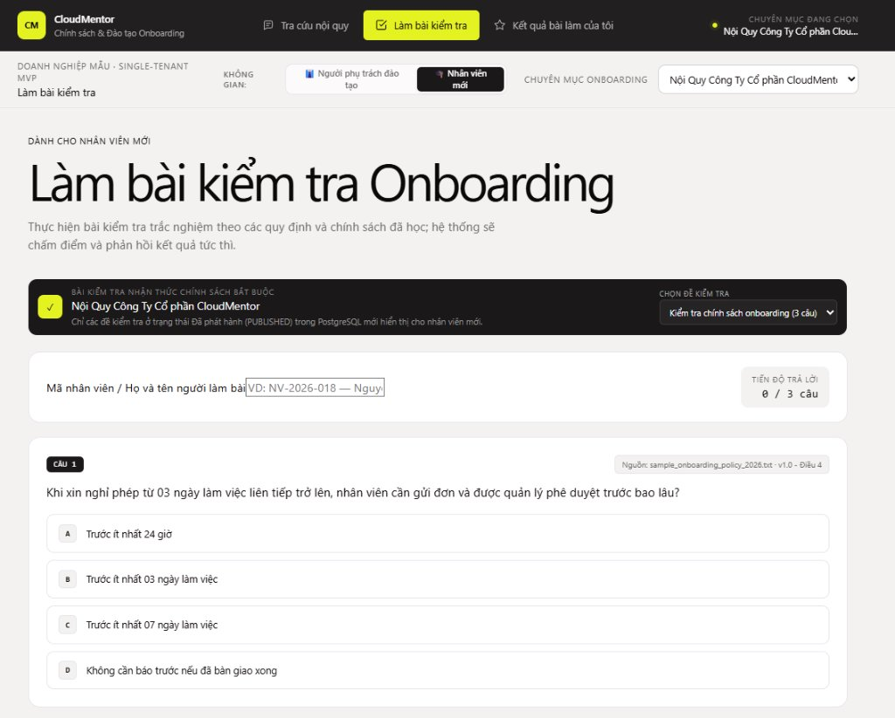
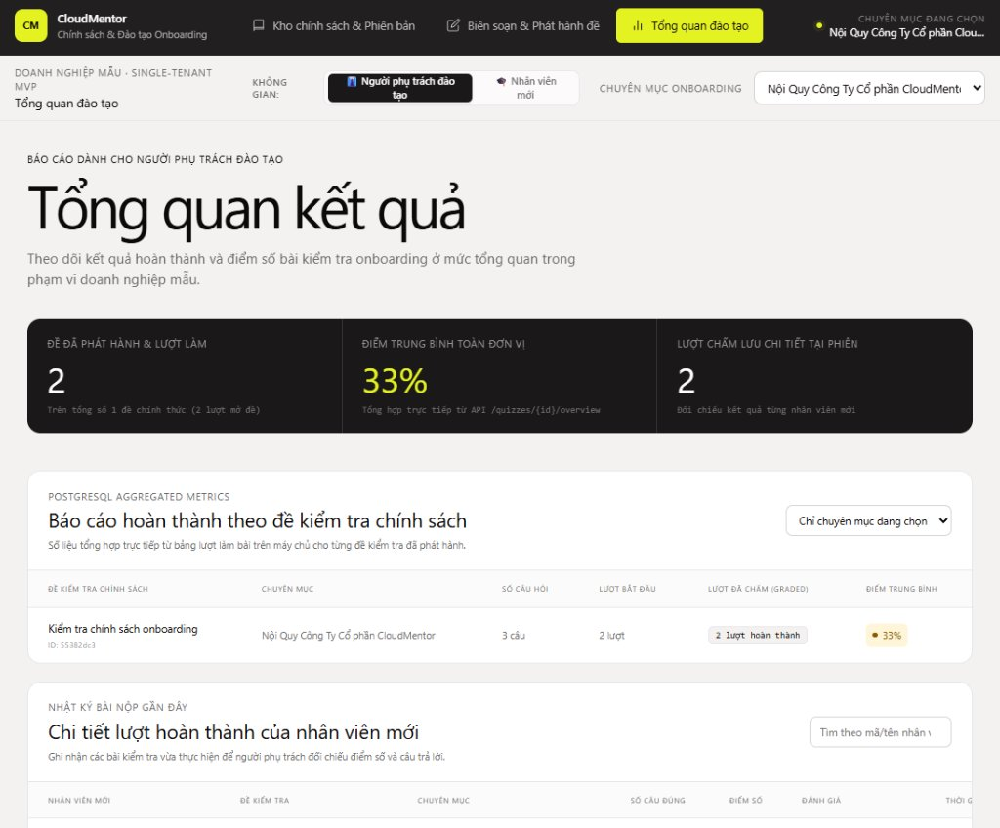
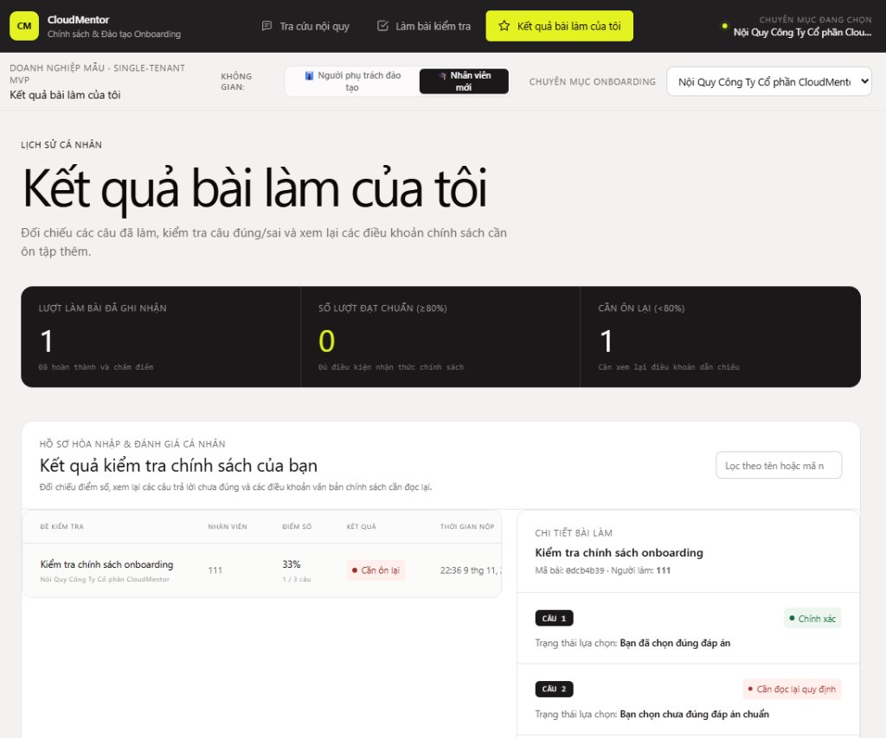
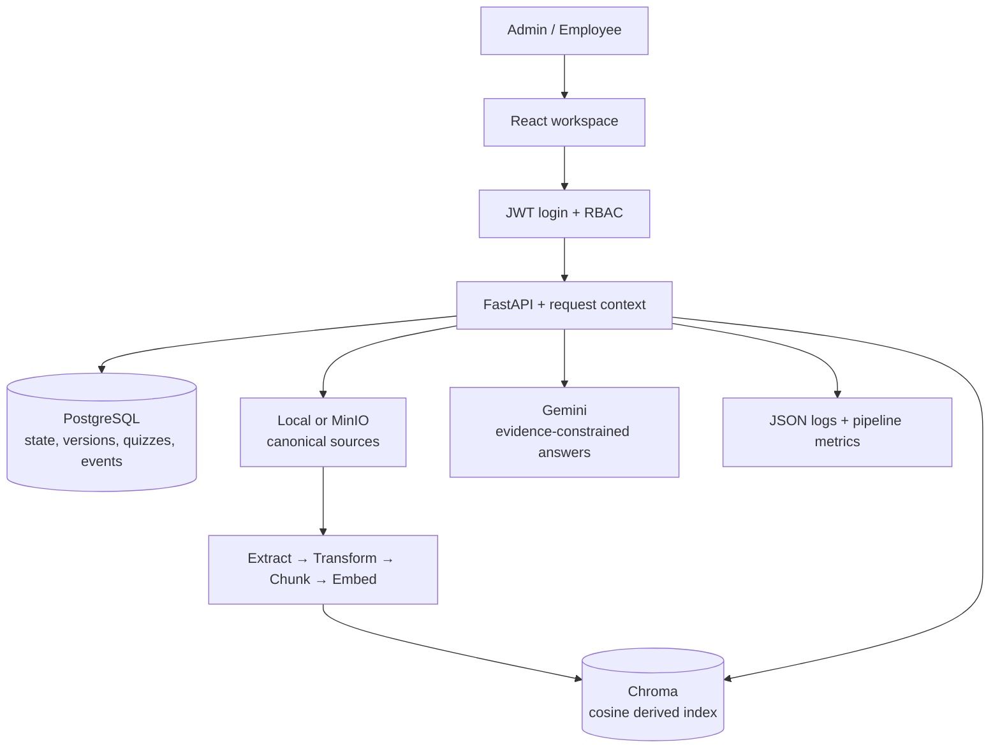

# CloudMentor AI

[](https://github.com/tonthatgiahuy16/CloudMentor-AI/actions/workflows/tests.yml)

CloudMentor AI is an enterprise policy and onboarding platform. Employees retrieve answers grounded in policies valid for a selected effective date; training admins publish and review onboarding quizzes graded on the server.

**Stack:** FastAPI · PostgreSQL · Chroma · MinIO · Gemini · React/TypeScript

This is a single-company MVP using sample identities and sample policy content. It is not a production HR or legal-compliance system.

## Screenshots

All screenshots were captured locally with `DEMO_MODE=false`. The optional public-demo configuration is read-only, so it does not represent the authoring or quiz-attempt flows below.



<details>
<summary><b>Employee lookup, quiz, and training workflows</b></summary>

### Employee Policy Lookup & Source Lineage



| Training Admin Workspace | Employee Workspace |
| :--- | :--- |
| **Quiz Authoring & Publishing**<br><br>*Draft and publish policy-linked quizzes.* | **Taking an Onboarding Quiz**<br><br>*Complete server-graded policy quizzes.* |
| **Training Analytics Overview**<br><br>*Review aggregate completion and scores.* | **Personal Quiz Review**<br><br>*Review a completed attempt and its policy context.* |

</details>

## Engineering Highlights

- **System of record vs. derived index:** PostgreSQL owns policy state, effective versions, quiz records, and attempts; Chroma is a rebuildable cosine-space index from retained local or MinIO sources.
- **Effective-dated RAG:** PostgreSQL resolves eligible `document_id` values before vector retrieval, preventing expired or superseded policy versions from entering answer context.
- **Security & RBAC:** Argon2id password hashing, JWT HS256 access tokens, `admin`/`employee` roles, owner-scoped quiz attempts, and route-inventory authorization tests.
- **Observability:** `X-Request-ID`, redacted JSON logs, persisted `document_processing_events`, and admin-only pipeline metrics with p50/p95 durations.
- **Consistency & recovery:** PostgreSQL duplicate protection, deterministic UUID v5 chunk identities, dry-run-first repair scripts, and rebuildable derived storage support controlled recovery.
- **Fail-fast vector safety:** the API rejects an existing Chroma collection whose distance space differs from configured cosine space and requires an explicit rebuild.

## Architecture



PostgreSQL is authoritative for policy applicability. The API resolves eligible policy versions before querying Chroma, so stale vectors cannot make an obsolete policy eligible for an answer.

## Verified Baseline

| Check | Latest local evidence |
| --- | --- |
| Backend suite | `488 passed, 3 skipped, 2 warnings in 22.98s` |
| Frontend | `npm run lint` and production build passed |
| Static validation | `compileall -q app`, `git diff --check`, and `docker compose config` passed |
| Retrieval evaluation | 39-case `cosine` sweep (`BAAI/bge-m3`): `27/27` (`100%`) answerable hit rate at `0.50`; calibration recommends `0.55` (`26/27` = `96.3%` hit rate, unanswerable context rate drops from `11/12` to `7/12`) |
| Optional integration tests | Two MinIO recovery tests and one PostgreSQL concurrency test are opt-in |

The full evidence record, historical runs, and limitations are in [Project Status](docs/PROJECT_STATUS.md).

## Quick Start

1. Copy the environment template and replace its placeholder secrets. Keep `DATABASE_URL` consistent with `POSTGRES_USER`, `POSTGRES_PASSWORD`, and `POSTGRES_DB`.

   ```powershell
   Copy-Item .env.example .env
   ```

2. Start local PostgreSQL and MinIO.

   ```powershell
   docker compose up -d
   ```

   PostgreSQL and MinIO start together, but source storage defaults to
   `local`. Set `CLOUDMENTOR_SOURCE_STORAGE=minio` only after configuring
   the MinIO values in `.env`.

3. Install backend dependencies, apply schema migrations, and create an
   admin and employee account.

   ```powershell
   python -m venv .venv
   .\.venv\Scripts\Activate.ps1
   python -m pip install -r requirements.txt
   alembic upgrade head
   python -m scripts.create_user --employee-id admin --role admin
   python -m scripts.create_user --employee-id employee --role employee
   ```

   A new local environment starts empty. Sign in as `admin` to create a
   subject, upload a policy, and publish a quiz; then sign in as `employee`
   to test policy lookup and quiz completion.

4. Run the API and frontend in separate terminals.

   ```powershell
   python -m uvicorn app.main:app --reload
   ```

   ```powershell
   cd frontend
   npm ci
   npm run dev
   ```

> PostgreSQL reads its initial credentials only when its Docker volume is first created. Changing `.env` later does not modify an existing database user's password.

<details>
<summary><b>Operator workflows</b></summary>

- Review and rebuild a Chroma collection after a vector-space migration: [Auth, observability, and retrieval operations](docs/AUTH_OBSERVABILITY_OPERATIONS.md).
- Inspect implementation evidence, reconciliation boundaries, and optional integration-test setup: [Project Status](docs/PROJECT_STATUS.md).
- Run backend checks with a project-local pytest temporary directory:

  ```powershell
  python -m pytest -q --basetemp .pytest-tmp-full
  ```

</details>

## Known Scope & Docs Map

CloudMentor AI implements authentication and role-based access for a single-company demo, but it does not yet provide multi-tenant isolation. Independent backups and restore drills, external monitoring/alerting, and shared rate limiting remain outside the current scope. The answer-level evaluation set also needs broader, harder human-reviewed examples.

| Document | Use it for |
| --- | --- |
| [Target Architecture](docs/TARGET_ARCHITECTURE.md) | System design, ownership boundaries, and planned work |
| [Project Status](docs/PROJECT_STATUS.md) | Verified capabilities, test evidence, and known limitations |
| [Auth & Operations](docs/AUTH_OBSERVABILITY_OPERATIONS.md) | Access policy, metrics, retrieval calibration, and Chroma rebuilds |

---

**Ton That Gia Huy** · Data Engineering and Backend candidate
[GitHub](https://github.com/tonthatgiahuy16) · [LinkedIn](https://www.linkedin.com/in/ton-that-gia-huy)
