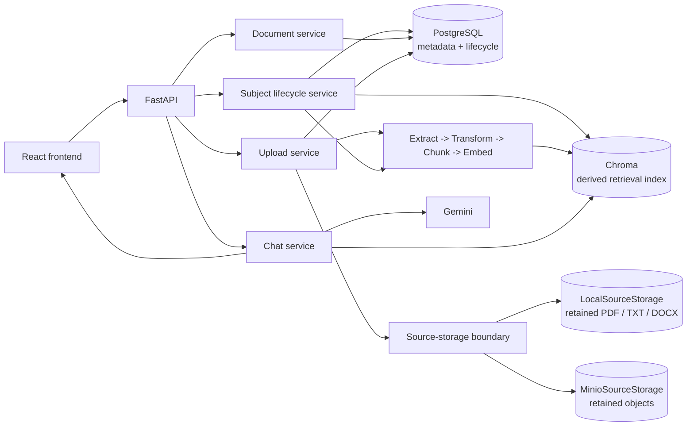

# CloudMentor AI

[](https://github.com/tonthatgiahuy16/CloudMentor-AI/actions/workflows/tests.yml)

> A document-data platform for subject-scoped RAG, built around traceable ingestion, PostgreSQL lifecycle management, and a Chroma vector index designed to be rebuildable.

CloudMentor AI is a data engineering-focused project that explores how learning documents can be converted into structured, traceable data for retrieval and LLM-based applications.

Data Engineering is the backbone of the project. The main concerns are ingestion, metadata propagation, lifecycle state, data ownership, retrieval boundaries, validation, and recovery. RAG and the frontend consume the data produced by that backbone.

## Current milestone

CloudMentor AI currently implements a recoverable, subject-scoped RAG lifecycle for PDF, UTF-8 TXT, and body-paragraph DOCX sources with configurable local-filesystem or MinIO source storage:

```text
create subject
    -> validate and retain a canonical source
    -> record source URI, SHA-256, and file size in PostgreSQL
    -> extract, clean, and preserve page, line, or paragraph locations
    -> chunk, embed, and index with source lineage
    -> track processing and document lifecycle in PostgreSQL
    -> ask a subject-scoped question
    -> return an answer constrained by retrieved context
    -> show document plus page, line-range, or paragraph-range references
    -> delete a document from active retrieval
       or move a subject to Trash
           -> remove its derived Chroma vectors
           -> retain PostgreSQL metadata and canonical source files
           -> restore the subject by rebuilding Chroma
```

The lifecycle is covered by automated application-level tests and recorded live local verification. Deterministic test doubles replace external embedding and answer generation in the application-level lifecycle test, and CI does not yet exercise live PostgreSQL, Chroma, embedding, and Gemini as one workflow. MinIO recovery hardening verifies missing-source and checksum-mismatch handling before vector deletion, translates temporary storage failures at the adapter boundary, and records a live local outage followed by successful restore retry. PostgreSQL-Chroma reconciliation is dry-run-first and can explicitly repair orphan vectors or rebuild an `INDEXED` document with no derived vectors. The current baseline, exact evidence, and remaining limitations are maintained in [`docs/PROJECT_STATUS.md`](docs/PROJECT_STATUS.md). The project does not claim production readiness: independent backups are not established, some legacy rows lack complete source metadata, and several operational and security boundaries remain.

## What this project demonstrates

- A modular **Extract -> Transform -> Chunk -> Embed -> Index** pipeline.
- Page-, line-, paragraph-, document-, chunk-, and subject-level metadata propagated through ingestion and retrieval.
- PostgreSQL lifecycle records linked to Chroma entries through `document_id`.
- Subject-scoped retrieval to keep queries inside the selected knowledge domain.
- Context-based LLM answers with format-aware source references; a narrow four-case retrieval and answer-level evaluation baseline checks expected citation coverage automatically and records human-reviewed correctness, faithfulness, and refusal behavior. Broader retrieval relevance and answer quality remain unbenchmarked.
- Database-enforced duplicate protection for concurrent ingestion, failed-document retry, stale-ingestion recovery, and subject trash/restore workflows.
- A dry-run-first PostgreSQL-Chroma reconciliation workflow with bounded, logged repair for orphan vectors and indexed documents missing all vectors.
- An injectable source-storage boundary with local-filesystem and MinIO implementations for canonical source writes, reads, retries, and rebuilds.
- A dry-run-first local-to-MinIO migration workflow with checksum, size, object read-back, conditional PostgreSQL update, and idempotent rerun protection.
- Recovery hardening that distinguishes a missing or changed retained source from temporary MinIO unavailability, preserving document identity and avoiding derived-index deletion before source validation.
- Clear boundaries between API, services, repositories, pipeline stages, retrieval, and generation.
- Dependency injection that allows API and orchestration tests to run without live external services.
- Automated backend and frontend checks in GitHub Actions.

## Technology stack

| Layer | Technology | Role |
| --- | --- | --- |
| API | FastAPI | Upload, document, subject, and chat endpoints |
| Relational storage | PostgreSQL + SQLAlchemy | Document metadata and lifecycle state |
| Source extraction | PyMuPDF, UTF-8 text loading, python-docx | PDF pages, TXT lines, and DOCX body paragraphs |
| Source files | Local filesystem or MinIO through a shared storage contract | Canonical source retention for retry and rebuild |
| Embeddings | BGE-M3 | Document and query vector generation |
| Vector index | Chroma | Similarity search over derived chunk embeddings |
| Generation | Gemini | Answer generation from retrieved context |
| Frontend | React + TypeScript + Vite | Document library, upload, subject management, and chat |
| Quality checks | Pytest, ESLint, TypeScript, GitHub Actions | Regression and build validation |

## Data flow

```text
PDF, UTF-8 TXT, or body-paragraph DOCX upload
    -> validate extension, media type, content, filename, and size
    -> retain the accepted source through the configured storage adapter
    -> record source URI, SHA-256, and file size
    -> create PostgreSQL document record as UPLOADED
    -> mark PROCESSING
    -> extract text by page, line, or paragraph
    -> normalize text without losing source boundaries
    -> create overlapping chunks with lineage metadata
    -> generate embeddings
    -> write derived vectors and metadata to Chroma
    -> mark INDEXED

Pipeline failure
    -> record FAILED status, failure stage, and error details

Question + required subject_id
    -> embed question
    -> retrieve matching chunks filtered by subject
    -> generate an answer constrained by retrieved context
    -> return answer plus document and format-aware location references

Subject moved to Trash
    -> mark the subject DELETED in PostgreSQL
    -> remove its derived Chroma chunks
    -> retain document records, canonical source files, and source metadata

Subject restore
    -> validate each retained source through the storage boundary
    -> rebuild Chroma under the original document identity
    -> return the subject to ACTIVE when recovery succeeds
```

## Architecture



Canonical sources are written and read through a shared storage interface implemented by `LocalSourceStorage` and `MinioSourceStorage`. Extraction consumes validated source bytes plus the filename and document type, so retry and rebuild do not depend on interpreting `source_uri` as a local path. The factory selects one adapter for upload, subject restore, and stale-ingestion recovery.

## Data ownership and recovery boundary

| Data | Current owner | Recovery meaning |
| --- | --- | --- |
| Subject, document metadata, and lifecycle state | PostgreSQL | System of record for operational state |
| Accepted PDF, TXT, and DOCX sources | Configured `LocalSourceStorage` or `MinioSourceStorage` | Retained for retry and rebuild; MinIO is currently operated as a local service rather than independently backed-up production storage |
| Chunk embeddings and retrieval metadata | Chroma | Derived index used for retrieval |
| Generated answer | API response | Not currently treated as a durable record |

PostgreSQL is the system of record for document identity, source metadata, and lifecycle state. Chroma is a derived retrieval index. Subject restore can rebuild Chroma from canonical bytes read through either storage adapter while preserving `document_id`, and the reconciliation audit can report drift between PostgreSQL and Chroma.

The current MinIO recovery guarantee is verified locally rather than production-durable. Eligible existing local sources have been migrated with read-back checksum verification while their local copies remain retained. Automated recovery tests cover missing objects, changed bytes, service failures, connection failures, and interrupted reads; a live local MinIO outage was followed by a successful restore retry under the same `document_id`. Independent source-file and PostgreSQL backups remain the next storage prerequisite for a production claim.

## Document lifecycle

```text
Document lifecycle:
UPLOADED -> PROCESSING -> INDEXED
                      \-> FAILED
INDEXED or FAILED -> DELETED

Subject lifecycle:
ACTIVE -> DELETING -> DELETED
                    \-> DELETE_FAILED
DELETED -> RESTORING -> ACTIVE
                     \-> RESTORE_FAILED
```

- `UPLOADED`: the file passed API validation and a document record was created.
- `PROCESSING`: extraction, transformation, embedding, or indexing is running.
- `INDEXED`: vector entries were written successfully.
- `FAILED`: the failed stage and error details were recorded for diagnosis.
- Document `DELETED`: the document is excluded from active use; there is no individual-document restore endpoint.
- Subject `DELETED`: the subject is hidden from active use while its non-deleted document records and retained sources remain available for subject restore.

Document deletion and subject trash remove derived records from active retrieval. Subject restore rebuilds retained documents. The PostgreSQL-Chroma reconciliation workflow reports missing lineage, missing indexed documents, unknown documents, known non-expected documents, and subject mismatches; its explicit repair mode can delete orphan vectors and rebuild `INDEXED` documents that have no vectors. Other drift classifications remain report-only.

## Traceability

The ingestion path carries metadata needed to trace a retrieval result back to the source material:

- `document_id`
- `subject_id`
- `source`
- exactly one source location: `page`, `line_range`, or `paragraph_range`
- `chunk_index`
- vector distance

The chat API returns document and format-aware location references alongside the answer. These references improve inspectability, but they do not by themselves prove answer grounding. A narrow four-case retrieval and answer-level evaluation baseline now checks expected citation coverage automatically and records human-reviewed correctness, faithfulness, and refusal behavior; broader quality still requires a larger benchmark.

## API surface

| Method | Path | Purpose |
| --- | --- | --- |
| `GET` | `/` | API root message |
| `GET` | `/subjects/` | List subjects |
| `GET` | `/subjects/trash` | List recoverable subjects in Trash |
| `POST` | `/subjects/` | Create a subject |
| `DELETE` | `/subjects/{subject_id}` | Move a subject to Trash and remove derived chunks |
| `POST` | `/subjects/{subject_id}/restore` | Rebuild retained documents and restore a subject |
| `POST` | `/upload/` | Validate and ingest a PDF, UTF-8 TXT, or body-paragraph DOCX |
| `GET` | `/documents/` | List active documents |
| `GET` | `/documents/{document_id}` | Read document metadata |
| `DELETE` | `/documents/{document_id}` | Remove a document from active use |
| `POST` | `/chat/` | Ask a question and receive answer plus sources |

`GET /` is an API root message, not a health check. Dedicated health and readiness endpoints have not yet been implemented.

Interactive API documentation is available at `http://127.0.0.1:8000/docs` while the backend is running.

## Frontend capabilities

- List documents and their processing status.
- Upload a PDF, UTF-8 TXT, or body-paragraph DOCX for a selected subject and optional chapter.
- Create a new subject from the document workspace.
- Delete a document.
- Select a subject before asking a question.
- Move subjects to Trash and restore them from retained sources.
- Render the answer and its document plus page, line-range, or paragraph-range references.

## Verification status

The current application baseline, capability matrix, CI evidence, verified boundaries, and remaining limitations are recorded in [`docs/PROJECT_STATUS.md`](docs/PROJECT_STATUS.md).

The long-term approved design is documented in [`docs/TARGET_ARCHITECTURE.md`](docs/TARGET_ARCHITECTURE.md).

## Repository structure

```text
CloudMentor-AI/
|-- .github/
|   `-- workflows/       # backend and frontend CI checks
|-- alembic/             # database migrations
|-- app/
|   |-- api/             # FastAPI routes
|   |-- core/            # configuration and database setup
|   |-- db_models/       # SQLAlchemy persistence models
|   |-- llm/             # prompt and model integration
|   |-- pipeline/        # extraction, transformation, and indexing stages
|   |-- rag/             # loader, chunker, embedder, retriever, vector store
|   |-- repos/           # persistence access
|   |-- schemas/         # API request and response models
|   |-- services/        # application orchestration
|   `-- storage/         # source-storage interfaces and implementations
|-- docs/
|   |-- PROJECT_GOALS.md
|   |-- PROJECT_STATUS.md
|   `-- TARGET_ARCHITECTURE.md
|-- frontend/            # React + TypeScript client
|-- scripts/             # controlled maintenance and migration scripts
|-- storage/             # generated local runtime storage; Git-ignored
|-- tests/               # backend unit and API tests
|-- alembic.ini
|-- pyproject.toml
|-- requirements.txt
|-- requirements-test.txt
`-- README.md
```

## Local development

### Prerequisites

- Python 3.11
- Node.js and npm
- PostgreSQL
- A Gemini API key

### Backend

```powershell
cd CloudMentor-AI
python -m venv .venv
.\.venv\Scripts\Activate.ps1
python -m pip install -r requirements.txt
Copy-Item .env.example .env
```

Set the required values in `.env`, then start the API:

```powershell
python -m uvicorn app.main:app --reload
```

Do not commit `.env`, API keys, passwords, or connection strings.

### Source storage

`CLOUDMENTOR_SOURCE_STORAGE` selects the source adapter. The default is `local`, using `CLOUDMENTOR_UPLOAD_DIR`. Set it to `minio` only after a MinIO server and bucket already exist, then provide the endpoint, access key, secret key, bucket, and secure-transport flag shown in `.env.example`.

The application does not create the bucket or delete local copies automatically. Existing sources are migrated only through the explicit operator command below. Credentials belong in environment variables or an uncommitted `.env` file; never place real values in source control.

### Local source migration to MinIO

The migration command is dry-run-first. With both local and MinIO storage settings configured, inspect eligible, already migrated, and incomplete records without changing state:

```powershell
python -m scripts.migrate_local_sources_to_minio
```

Apply the verified plan explicitly:

```powershell
python -m scripts.migrate_local_sources_to_minio --apply
```

For each eligible document, apply revalidates the local bytes, writes the deterministic MinIO object, reads it back, verifies SHA-256 and size, and conditionally changes only `source_uri` in PostgreSQL. Local source files are intentionally retained. Rerun dry mode after apply to confirm that no eligible documents remain.

### PostgreSQL-Chroma reconciliation repair

Audit cross-store state without changing it:

```powershell
python -m scripts.reconcile_postgres_chroma
```

Print a repair plan before applying it:

```powershell
python -m scripts.reconcile_postgres_chroma --repair
```

Apply only the bounded repair actions explicitly:

```powershell
python -m scripts.reconcile_postgres_chroma --repair --apply
```

Repair deletes orphan Chroma chunks and rebuilds `INDEXED` documents that have no Chroma chunks from their retained source. Each planned, applied, or failed action is logged; failures return a nonzero exit code and do not stop independent repair actions. Chunks with missing lineage, known non-expected documents, and subject mismatches remain report-only for operator review.

### Frontend

```powershell
cd frontend
npm ci
npm run dev
```

The local frontend expects the API at `http://127.0.0.1:8000` unless a Vite environment override is configured.

### Windows application-control note

On a Windows machine where Application Control blocks binary Python extensions, the PostgreSQL driver may need its pure-Python implementation and the PostgreSQL client libraries on `PATH`:

```powershell
$env:Path = "C:\Program Files\PostgreSQL\18\bin;$env:Path"
$env:PSYCOPG_IMPL = "python"
```

Adjust the PostgreSQL version in the path for the local installation. This is a machine-specific workaround, not an application configuration requirement.

## Tests and checks

Run backend tests from the repository root:

```powershell
python -m pytest -q -p no:cacheprovider --basetemp .codex_pytest_tmp
Remove-Item .codex_pytest_tmp -Recurse -Force
```

Run frontend checks from `frontend/`:

```powershell
npm run lint
npm run build
```

Check staged or unstaged whitespace errors before committing:

```powershell
git diff --check
git diff --cached --check
```

## Legacy subject metadata migration

The repository includes a controlled script for backfilling missing `subject_id` metadata in legacy Chroma chunks. Migration evidence is recorded in [`docs/PROJECT_STATUS.md`](docs/PROJECT_STATUS.md).

The script contains project-specific mappings. Review the mapping, back up the Chroma data, and run a dry run before applying it to another environment.

## Current limitations

- In the 2026-10-21 status snapshot, all eight eligible local sources were moved to verified MinIO objects while their local copies were retained; ten legacy rows with incomplete source metadata remained outside automatic migration.
- The verified MinIO instance is local and does not replace independent source-file and PostgreSQL backups.
- Missing objects, changed bytes, temporary service failures, connection failures, and interrupted reads are covered by automated storage and recovery tests; only the temporary-outage retry has been exercised against a live local MinIO service.
- MinIO recovery is exercised by a pinned container-backed GitHub Actions job, but the deployed local MinIO service remains manually operated.
- Concurrent duplicate protection is enforced at the PostgreSQL boundary, but production throughput, timeout, and contention behavior have not been benchmarked.
- Stale-ingestion recovery, legacy-source repair, and unresolved reconciliation drift still require operator action. Legacy documents without retained-source metadata require the correct original source file.
- PostgreSQL-Chroma reconciliation repair is intentionally bounded: only orphan chunks and `INDEXED` documents with no chunks are eligible; missing lineage, known non-expected documents, and subject mismatches remain report-only.
- TXT ingestion is limited to UTF-8. DOCX ingestion supports body paragraphs; non-empty tables are rejected, and headers, footers, text boxes, images, and other complex Word structures are not extracted.
- A narrow four-case retrieval and answer-level evaluation baseline exists across TXT, DOCX, and PDF. Citation coverage is checked automatically, while correctness, faithfulness, and refusal are human-reviewed; broader retrieval relevance and answer quality remain unbenchmarked.
- Integration tests do not yet cover live PostgreSQL, Chroma, embedding, and Gemini boundaries as one workflow.
- Structured operational logging, metrics, tracing, and alerting are incomplete.
- Authentication, authorization, rate limiting, and production deployment are not implemented.
- Dedicated health and readiness checks are not implemented.

## Engineering principles

- PostgreSQL owns metadata and lifecycle state.
- Chroma is a derived retrieval index, not the source of truth.
- Every chunk should preserve lineage back to its subject, document, exactly one format-aware source location, and chunk position.
- Pipeline stages should be independently testable and observable.
- Recovery claims must be backed by durable source data and a tested procedure.
- New infrastructure should be introduced only when the workload justifies it.

## Author

**Ton That Gia Huy**

Data Engineering and Backend candidate focused on reliable data pipelines, lifecycle management, and applied AI systems.

- GitHub: [tonthatgiahuy16](https://github.com/tonthatgiahuy16)
- LinkedIn: [ton-that-gia-huy](https://www.linkedin.com/in/ton-that-gia-huy)
