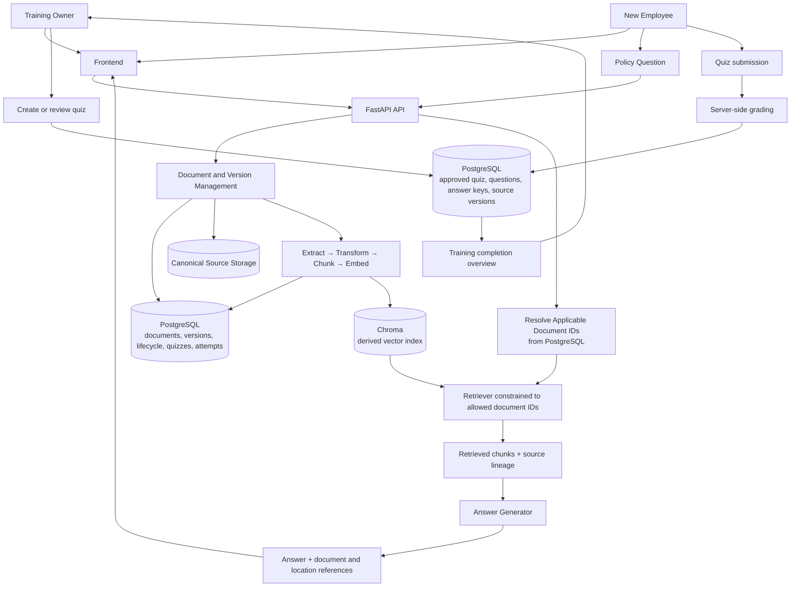

# CloudMentor AI — Target Architecture


> **CloudMentor AI** is an Enterprise Policy and Knowledge Platform for employee onboarding. It helps employees find answers grounded in current internal policies and helps training owners deliver reviewed onboarding quizzes.

> [!IMPORTANT]
> This document describes the target architecture and the agreed MVP boundary. It does not claim that planned capabilities are implemented. See [`PROJECT_STATUS.md`](./PROJECT_STATUS.md) for the verified application baseline.

The product goals are described in [`PROJECT_GOALS.md`](./PROJECT_GOALS.md). PostgreSQL is the system of record for policy metadata, version applicability, and training records. Chroma is a derived retrieval index; it is never authoritative for whether a policy version is applicable.

## 1. Product Scope

### MVP

The first product slice supports one sample company and a focused onboarding policy collection:

- A training owner uploads and manages onboarding documents.
- Employees ask questions and receive answers grounded in applicable documents, with inspectable source references.
- A training owner creates or reviews quiz questions before employees can take them.
- The server grades submissions against approved answer keys and records training results.

The MVP does not include multi-company tenancy, fine-grained department-based authorization, HR-system integrations, automated employment or legal decisions, advanced analytics, Kafka, Spark, or machine-learning recommendations. Use sample data until authentication and authorization are implemented and reviewed for real employee data.

### Design principles

- Reuse the existing document ingestion, canonical source storage, lineage, lifecycle, and recovery foundations where they fit.
- Keep PostgreSQL authoritative for document identity, version lifecycle, approved quiz content, and attempts.
- Treat Chroma as a disposable, rebuildable index of document chunks.
- Fail closed: if the applicable document set cannot be resolved or indexed evidence is unavailable, do not silently fall back to obsolete policy content.
- Add distributed processing and analytics only when a measured workload or product requirement justifies them.

## 2. Architecture Overview



### Main data flows

**Policy document ingestion and version activation**

```text
Upload -> Validate and retain canonical source
       -> Extract -> Transform -> Chunk -> Embed -> Index in Chroma
       -> Verify indexing and lineage
       -> PostgreSQL records version lifecycle and applicability
```

A new version is not made applicable until its source is retained, processing succeeds, and its index records are verified. PostgreSQL owns the activation decision. Version transitions must be represented as explicit lifecycle operations; PostgreSQL and Chroma do not share a transaction.

An unactivated document has no `effective_from` date and is excluded from policy retrieval. The activation operation accepts an effective date and an optional document being replaced. It requires the new document to be `INDEXED`, to have retained source metadata, and to have the same verified chunk count in PostgreSQL and Chroma. Activation and the replaced document's exclusive `effective_until` date are committed together in PostgreSQL. Existing indexed documents are backfilled from their upload date during migration to preserve their current availability.

**Policy question and answer**

```text
Question + category -> PostgreSQL resolves applicable document_ids
                    -> Retriever searches Chroma only within those IDs
                    -> Context-constrained answer generation
                    -> Answer + document/version/location references
```

The MVP answers using currently applicable policy versions. Historical “what applied at a past date?” queries are outside the initial scope. If PostgreSQL cannot resolve an applicable set, or no eligible indexed evidence is available, the system returns a controlled no-evidence response instead of using stale chunks.

**Quiz authoring and completion**

```text
Training owner creates or reviews questions
                    -> PostgreSQL stores approved questions, answer keys,
                       and source document/version references
Employee takes an approved quiz -> Submission -> Server-side grading
                                -> PostgreSQL stores attempt and result
                                -> Training owner views completion overview
```

An LLM may assist with draft question generation in a later iteration, but generated questions and answers require human review before publication. The client never supplies the authoritative answer key or grading result.

## 3. Policy Versioning and Retrieval Safety

PostgreSQL is the authority for which policy documents may support an answer. Chroma metadata is useful for candidate search and diagnostics, but a `current` flag copied into Chroma is not sufficient to establish applicability.

For each question, the application resolves the eligible `document_id` set from PostgreSQL using the MVP's version and effective-date rules. The retriever constrains Chroma search to that set. The implementation must verify that the installed Chroma version and query path support the required filter form; if not, it must use a safe alternative that still enforces the PostgreSQL allow-list and does not return stale content.

Version replacement follows a guarded sequence:

1. Retain and register the new source version.
2. Process and index it while it is not yet applicable.
3. Verify expected chunks and their document/source lineage.
4. In a PostgreSQL transaction, update the applicability state so the new version becomes active and the replaced version ceases to be eligible.
5. Reconcile or remove stale derived chunks separately; correctness must not depend on immediate Chroma metadata mutation or deletion.

This avoids requiring a distributed transaction between PostgreSQL and Chroma. If indexing or verification fails, the new version is not activated. If Chroma still contains old chunks after a version transition, PostgreSQL's eligible document IDs prevent their use in new answers. Retrieval must fail closed when it cannot enforce that restriction.

Effective-date and supersession rules must be explicit in the data contract. At minimum, the application needs to distinguish a registered version from one that is applicable now. The exact treatment of future-dated and expired policies must be consistent in PostgreSQL selection and API behavior.

## 4. Component Responsibilities

| Area | Component | Responsibility |
| --- | --- | --- |
| Experience | Frontend | Provide policy upload/management, employee question flow, approved quiz flow, and training overview. Clearly distinguish unavailable data from empty results. |
| API | FastAPI routes | Validate requests, enforce the available access boundary, and return stable response contracts. Authentication and authorization are prerequisites before real employee data is used. |
| Policy control | PostgreSQL document registry | Own document identity, category/scope, source metadata, version relationships, effective dates, lifecycle, and applicability. |
| Source retention | Local or MinIO source storage | Retain canonical source bytes used for processing, citation, retry, and rebuild. |
| Ingestion | Extract, transform, chunk, embed | Convert supported sources into chunks while preserving document identity and page/line/paragraph locations. |
| Derived retrieval | Chroma | Store searchable vectors and retrieval metadata. It can be reconciled or rebuilt from canonical sources and PostgreSQL records. |
| Version resolver | PostgreSQL-backed application service | Resolve the `document_id` allow-list for a question before retrieval. It is the authority for applicability. |
| RAG read path | Retriever and answer generator | Search only allowed document IDs, preserve lineage, constrain generation to retrieved evidence, and return inspectable citations. |
| Quiz authoring | PostgreSQL-backed quiz module | Store approved quiz definitions, questions, answer keys, and source document/version references. Draft generation is not publication. |
| Training records | PostgreSQL-backed attempt service | Grade on the server and store the minimum required attempt, score, completion time, and employee association. |
| Operations | Lifecycle, reconciliation, and logs | Expose ingestion outcomes and cross-store drift; keep repair bounded, auditable, and operator-controlled where appropriate. |

The MVP uses one sample company and does not require a `company_id`/`tenant_id` filter in Chroma. Existing subject or category scoping may be reused only where its current semantics are verified and documented. Multi-company tenancy and department-level access controls are future design work, not implicit properties of this MVP.

## 5. Identity, Lineage, Quality, and Privacy Contracts

| Path | Identity that must survive | Checkable outcome |
| --- | --- | --- |
| Write | Retained source → `document_id` → version identity → `chunk_id` → Chroma record | Retry, delete, audit, and rebuild target the intended source version and all its derived chunks. |
| Policy read | Question/category → PostgreSQL eligible `document_id` set → retrieved `chunk_id` → document/version/location → answer | Every cited chunk belongs to an eligible document version; obsolete versions cannot enter the answer context. |
| Version activation | New source version → processing/index verification → PostgreSQL applicability transition | A failed or incomplete index does not make the new version applicable; old derived chunks are harmless to retrieval after they become ineligible. |
| Quiz | Approved quiz/question → answer key → source document/version → attempt/submission → graded result | The server grades against the approved stored key and the question's source version can be inspected. |
| Lifecycle | `document_id` → state transition, processing stage, failure, retry, delete, or rebuild action | An operator can identify the affected version and recover or reconcile it safely. |

Data quality checks should cover required metadata, non-empty extracted content, stable identities, expected indexed chunks, valid version relationships, approved quiz answer keys, and source references for published questions. RAG evaluation should include current-version and obsolete-version fixtures, citation checks, and no-evidence questions.

Quiz results associated with a named employee are employee-related data. The MVP should use sample identities. Before real deployment, define access controls, data minimization, retention, and deletion rules for attempts and training overviews. The system must not present quiz scores as employment, legal, or compliance determinations.

## 6. Reliability and Validation Requirements

| Risk | Target behavior | Validation evidence |
|---|---|---|
| PostgreSQL and Chroma version state diverges | PostgreSQL allow-list prevents obsolete chunks from reaching answer context, even if stale Chroma metadata remains. | Index an old version, transition applicability, leave its vectors untouched, and verify retrieval cannot return them. Also cover failed indexing of a new version. |
| New policy is only partially indexed | Do not activate the version until indexing and lineage checks pass. | Inject or simulate an indexing failure and verify the prior applicable version remains selected. |
| Quiz answer is ambiguous or wrong | Only human-approved questions and answer keys are published. | Review generated or manually authored questions against their cited source versions before publication; grading uses the stored key. |
| No eligible policy evidence exists | Return a controlled no-evidence response. | Ask unsupported questions and verify no unrelated or obsolete document is cited. |
| Chroma filter syntax or semantics differ by version | Verify the production query path with the installed dependency and retain a safe allow-list enforcement path. | Focused integration/contract coverage for the actual metadata types and combined query filters. |
| Employee result data is exposed too broadly | Restrict overview access and retain only necessary data before real identities are introduced. | Authorization checks and retention/deletion exercises before production use. |

Operational signals should include ingestion stage and outcome, version activation outcome, index verification, retrieval document IDs, citation lineage, quiz publication and grading outcomes, and reconciliation drift. Do not report a stage as healthy without evidence from its actual state.

## 7. Technology Boundaries

| Technology | Target responsibility | Boundary |
|---|---|---|
| Python / FastAPI | Application and ingestion APIs | Keep routes thin and business rules in services. |
| PostgreSQL | System of record for policies, versions, applicability, quizzes, answer keys, and training attempts | Owns business state and authoritative selection rules. |
| Chroma | Derived vector search index | Never owns policy applicability or canonical document state; can be reconciled/rebuilt. |
| Local / MinIO source storage | Canonical source bytes | Storage adapter boundary keeps processing independent of filesystem or object-store paths. |
| Gemini / LLM provider | Evidence-constrained answer generation; optional future draft assistance | Does not own policy truth, version state, approved quiz keys, or grading. |
| Kafka | Not in MVP | Add only when asynchronous processing has a measured workload or operational requirement. |
| Spark | Not in MVP | Add only when data volume or latency needs justify distributed processing. |
| Machine Learning | Not in MVP | No recommendations or employee scoring models before a justified, evaluated use case. |

## 8. Delivery Phases

| Phase | Status | Completion boundary |
|---|---|---|
| Existing foundation — Document ingestion and RAG | Implemented baseline; see [`PROJECT_STATUS.md`](./PROJECT_STATUS.md) | Supported source upload, lifecycle, retained source, indexing, scoped retrieval, citations, and recovery evidence as recorded in project status. This baseline does not itself establish enterprise policy versioning or employee access control. |
| MVP 1 — Policy versions and safe retrieval | Implemented baseline; see [`PROJECT_STATUS.md`](./PROJECT_STATUS.md) | PostgreSQL applicability rules select eligible document IDs using `effective_from` and exclusive `effective_until`; retrieval is constrained to those IDs; activation checks indexed-chunk consistency; source citations retain document lineage. Automated coverage and local end-to-end evidence are recorded in project status. |
| MVP 2 — Reviewed onboarding quizzes | Implemented baseline; see [`PROJECT_STATUS.md`](./PROJECT_STATUS.md) | PostgreSQL stores quizzes, questions, options, attempts, and answers; quiz questions retain source document/version references; server-side grading uses stored answer keys and bounded scores. Quiz content is administered through the demo workflow; generated drafts must be reviewed before publication. |
| MVP 3 — Onboarding experience | Implemented demo baseline; see [`PROJECT_STATUS.md`](./PROJECT_STATUS.md) | The frontend provides separate training-admin and employee workspaces, policy lookup, quiz authoring/publication, employee quiz attempts/results, and training overview. This is a demo-level UI distinction, not authenticated or backend-enforced role authorization. |
| Future — Authentication, authorization, and multi-company tenancy | Future, not MVP | Access is tenant- and role-scoped, with tested isolation before multiple companies or real employee data are supported. |
| Future — Event processing and advanced analytics | Future, needs justification | Kafka, Spark, or additional analytics are introduced only for measured scale, latency, or product needs. |

Promote a phase to implemented only when code, focused tests, and reproducible evidence exist. The current verified application capabilities and limitations belong in [`PROJECT_STATUS.md`](./PROJECT_STATUS.md), not in this target document as unverified claims.
