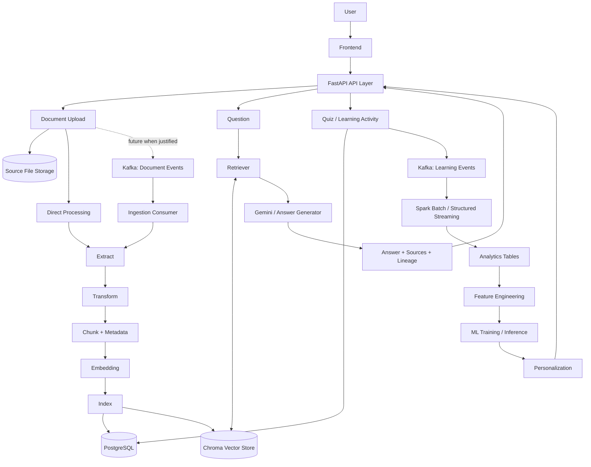

# CloudMentor AI — Target Architecture


> **CloudMentor AI** is an AI Learning Data Platform that uses **Data Engineering as its backbone** to transform documents and learning behavior into knowledge, analytics, and personalized learning.

> [!IMPORTANT]
> This document describes the approved long-term target architecture.
> Planned components are not current implementation claims.
> See [`PROJECT_STATUS.md`](./PROJECT_STATUS.md) for the verified baseline.

The product purpose and expected outcomes are in [`PROJECT_GOALS.md`](./PROJECT_GOALS.md). This design adapts the August 2026 *CloudMentor_AI_Final_Target_Architecture.docx* to the later implementation baseline; phase numbering follows the current repository rather than the older ten-step estimate in that document.

## 1. Project Overview

CloudMentor AI is designed as an end-to-end learning data platform, not merely a PDF chatbot.

The platform will:

- Ingest and manage learning documents from multiple formats.
- Build a searchable knowledge base for context-constrained RAG with source references.
- Generate and record Quiz interactions and learning history.
- Process document events and learning events at scale.
- Produce analytical datasets and Machine Learning features.
- Detect weak topics and recommend the next learning activity.

Overall value flow:

```text
Documents -> Data Platform -> Knowledge -> RAG / Quiz
          -> Learning Events -> Analytics -> Machine Learning
          -> Personalized Learning
```

### Project status

| Area | Status |
|---|---|
| Product vision and target architecture | Documented |
| Current Data Engineering implementation | See [`PROJECT_STATUS.md`](./PROJECT_STATUS.md) |
| Current RAG implementation | See [`PROJECT_STATUS.md`](./PROJECT_STATUS.md) |
| Kafka and Spark | Planned phases |
| Analytics and Machine Learning | Planned phases |

## 2. Architecture Diagram



### Main data flows

**Document ingestion**

```text
Upload -> Store source file -> Direct processing
       -> Extract -> Transform -> Chunk -> Embed -> Index
       -> PostgreSQL registry/lifecycle + Chroma vector index

Future asynchronous path when justified:
Upload -> Store source file -> Publish document event
       -> Consumer -> Extract -> Transform -> Chunk -> Embed -> Index
```

**RAG serving**

```text
Question -> Query embedding -> Retriever + metadata filters
         -> Relevant chunks -> Gemini
         -> Answer + source + page + document_id + chunk_id
```

**Learning analytics and personalization**

```text
Quiz / User Activity -> PostgreSQL + Kafka
                     -> Spark Batch / Streaming
                     -> Analytics -> Features -> ML
                     -> Recommendation
```

The following capabilities apply across all flows:

- Data Quality
- Observability
- Data Lineage
- Identity and metadata propagation
- Lifecycle and failure management

### Component responsibility map

This is the **target** responsibility map from the approved architecture report, condensed for use during implementation. Presence in this table does not mean that a component exists in the current application.

| Area | Component | Responsibility and intended output |
| --- | --- | --- |
| Experience | 1. Frontend | Collect upload, subject, question, quiz, and progress actions; render responses. |
| Experience | 2. FastAPI API layer | Validate requests and route them to services; return stable response contracts. |
| Control | 3. PostgreSQL subject registry | Own subject identity and metadata used for data scoping. |
| Control | 4. PostgreSQL document registry | Own document identity, lifecycle, timestamps, and failure metadata. |
| Control | 5. Kafka document events | Carry document events to consumers when asynchronous processing is justified. |
| Ingestion | 6. Extract | Convert supported source formats into raw document content. |
| Ingestion | 7. Transform | Clean and normalize extracted text. |
| Ingestion | 8. Chunk | Produce retrieval-sized text units with stable order and boundaries. |
| Ingestion | 9. Metadata and identity | Propagate document, chunk, subject, page, source, and version references. |
| Ingestion | 10. Embedding | Produce document and query vectors with a known model version. |
| Ingestion | 11. Index | Persist text, metadata, and vectors under stable record identities. |
| Ingestion | 12. Chroma | Serve similarity search and metadata filtering as a derived index. |
| RAG read path | 13. Retriever | Select relevant chunks within the requested scope. |
| RAG read path | 14. Read-path lineage | Preserve chunk, document, page, and source references through retrieval. |
| RAG read path | 15. Answer generator | Generate an answer from controlled retrieved context. |
| RAG read path | 16. Chat API response | Return the answer with references that users can inspect. |
| Lifecycle | 17. Document lifecycle | Record processing, failure, retry, and deletion state in PostgreSQL. |
| Lifecycle | 18. Delete by `document_id` | Remove all derived records for one document without filename matching. |
| Learning | 19. Quiz module | Own structured quizzes, questions, and answers in PostgreSQL. |
| Learning | 20. User attempts | Record answers, correctness, score, topic, and timestamp. |
| Learning | 21. Kafka learning events | Transport learning events when downstream decoupling is justified. |
| Analytics | 22. Spark batch | Build curated historical datasets when distributed processing is needed. |
| Analytics | 23. Spark Structured Streaming | Build continuous aggregates or features when latency requirements justify it. |
| Analytics | 24. Analytics layer | Produce progress, weak-topic, and quiz-difficulty measures. |
| ML | 25. Feature engineering | Create traceable and versioned model inputs from curated data. |
| ML | 26. Model training | Train and evaluate a model against an explicit baseline. |
| ML | 27. Model inference | Produce versioned predictions or rankings for application use. |
| ML | 28. Personalization | Choose a next learning activity using measured evidence. |
| Platform | 29. Observability | Expose lifecycle state, logs, metrics, health, and failure signals. |
| Platform | 30. Data quality | Check schema, completeness, duplicates, and cross-store consistency. |
| Platform | 31. Data lineage | Trace source-to-answer and attempt-to-recommendation paths. |

### Identity, lineage, and quality contracts

| Path | Identity that must survive | Checkable outcome |
| --- | --- | --- |
| Write | `source_uri` or retained file reference → `document_id` → `chunk_id` or `chunk_index` → index record | A retry, delete, or rebuild can select the intended document and all of its derived records. |
| Read | question and scope → retrieved `chunk_id` → `document_id`, page, source → answer | An answer's cited material can be inspected and its scope checked. |
| Learning | `user_id` → `attempt_id`, question, topic, score, time → event → aggregate → feature → model version | A recommendation can be traced back to the learning records and transformation that produced it. |
| Lifecycle | `document_id` → state transition, processing time, failure stage, retry and delete or rebuild action | An operator can identify what failed, what was affected, and how to resume safely. |

Stage boundaries need schema and required-field checks; content checks should catch empty text, missing metadata, and duplicates. Operational signals should include processing duration, throughput, failure counts, retrieval results, and event lag when event processing is introduced. These are design requirements; implementation and test coverage belong in [`PROJECT_STATUS.md`](./PROJECT_STATUS.md).

## 3. Business Value

### Problem

Learning materials are often fragmented across files and platforms. Traditional document search does not explain concepts well, while a standalone RAG chatbot cannot determine whether a learner is improving or which topic should be studied next.

### Solution

CloudMentor AI combines two data domains:

1. **Knowledge data:** subjects, documents, chapters, topics, chunks, and embeddings.
2. **Learning data:** quizzes, questions, answers, attempts, scores, and user activity.

This combination allows the platform to provide:

- Context-constrained answers with references that users can inspect.
- Structured practice through Quiz activities.
- Learning progress and weak-topic analytics.
- Recommendations based on historical learning behavior.

### Expected outcome

When the complete roadmap is delivered, the system should be able to produce guidance such as:

> You are currently weak in **Chapter 4 — Cloud Security**. Your three latest answers about **IAM** were incorrect. Review **Identity and Access Management**, then continue with the recommended basic Quiz.

The project creates value by turning raw learning content and user activity into measurable learning decisions—not by adding tools for their own sake.

## 4. Engineering Challenges & Solutions

> [!NOTE]
> At the current architecture stage, these are **design challenges and planned responses**. This section will later be replaced with problems actually encountered, evidence, and measured results from the implementation.

| Engineering challenge | Planned solution | How it will be validated |
|---|---|---|
| Large document binaries should not travel through Kafka | Store the source file separately; publish `document_id`, `source_uri`, metadata, and processing context | Event payload inspection and upload/load testing |
| PostgreSQL lifecycle and Chroma index may become inconsistent | Treat PostgreSQL as the system of record; make Chroma a rebuildable derived index | Failure injection, reconciliation, delete, and rebuild tests |
| Replayed events may create duplicate business effects | Use stable `event_id`, idempotent consumers, retry policy, and dead-letter handling | Replay the same event and verify one business outcome |
| Metadata may be lost between pipeline stages | Define stage contracts and propagate `document_id`, `chunk_id`, subject, page, and source | Contract and lineage tests across the complete pipeline |
| RAG answers may lack reliable evidence | Apply subject filters, retrieval thresholds, context-constrained prompting, and source serialization | Curated retrieval/answer evaluation set |
| Machine Learning may be introduced before enough quality data exists | Build Quiz history, analytics, and versioned features before model training | Data readiness checks and baseline comparison |
| Failures may be difficult to diagnose | Add lifecycle state, structured logs, metrics, correlation IDs, and alerts | Operational dashboards and failure-recovery exercises |

Actual implementation notes should eventually follow this format:

```text
Problem -> Root cause -> Design decision -> Trade-off
        -> Implementation -> Measured result -> Remaining limitation
```

## 5. Tech Stack Rationale

| Technology | Primary role | Why it fits | Boundary / trade-off | Status |
|---|---|---|---|---|
| **Python** | Pipeline and application language | Strong ecosystem for Data Engineering, RAG, and ML | Performance-critical workloads may need distributed or compiled components | Implemented baseline |
| **FastAPI** | Backend API layer | Typed contracts, validation, and async-friendly APIs | API should remain thin; long processing belongs in workers | Implemented baseline |
| **PostgreSQL** | Relational system of record | Transactions, constraints, joins, and canonical lifecycle state | Not the primary semantic vector-serving layer | Implemented baseline |
| **Chroma** | Vector serving index | Simple embedding storage, similarity search, and metadata filtering | Derived index; not the source of truth for business data | Implemented baseline |
| **MinIO** | Canonical source object-storage adapter | Stable object keys and S3-compatible byte access support retry and Chroma rebuild without filesystem-path coupling | Verified locally for new uploads and controlled migration; independent backups and production operations remain | Implemented local adapter and migration workflow |
| **Kafka** | Event transport and streaming backbone | Decoupling, buffering, replay, partitioning, and consumer scaling | Adds operational complexity; only justified by real async/scale requirements | Planned |
| **Spark** | Distributed batch/stream processing | Large-scale joins, aggregation, Structured Streaming, and feature engineering | Unnecessary overhead for small single-node workloads | Planned |
| **Gemini** | Context-constrained answer generation | Generates natural-language answers from retrieved context | Does not own knowledge, lifecycle, or canonical data | Implemented baseline |
| **Embedding model** | Semantic representation | Enables document/query similarity search | Requires evaluation and version tracking | Implemented baseline |
| **Docker Compose** | Reproducible local environment | Simplifies multi-service development and onboarding | Compose configuration must reflect actual implemented services | Planned |

### Core architecture decisions

- **PostgreSQL is the system of record; Chroma is a derived serving index designed to be rebuildable once durable canonical content and an automated rebuild workflow exist.**
- **Canonical source storage is selected behind one contract; application services consume source bytes rather than storage-specific paths or SDKs.**
- **Kafka transports events; it does not replace transactional storage.**
- **Spark processes data; it does not serve application requests.**
- **Gemini generates answers; retrieved context supplies the knowledge.**
- **RAG, Quiz, Analytics, and ML are consumers of the same data platform.**
- **Kafka, Spark, and ML are added only when latency, volume, complexity, or product value justifies them.**

## 6. Delivery Phases

Current setup and test instructions live in the repository [`README`](../README.md). Verified implementation status and evidence live in [`PROJECT_STATUS.md`](./PROJECT_STATUS.md).

### Delivery phases

| Phase | Status | Completion boundary |
| --- | --- | --- |
| Phase 1 — Core Data Foundation and RAG | Implemented baseline | Reproducible document upload → indexed state → scoped answer with source → delete; stable identity and stage contracts; automated coverage for the full local lifecycle. Manual verification is recorded separately. |
| Phase 2 — Reliability and Multi-source Ingestion | Implemented local baseline | Retained canonical content; supported PDF/TXT/DOCX under one document contract; quality checks, safe retries, idempotency, cross-store reconciliation, tested delete/rebuild recovery, local-filesystem and MinIO adapters, and dry-run-first migration of eligible retained local sources with read-back verification. Independent backups, failure hardening, and production operations remain separate work. |
| Phase 3 — Quiz and Learning Application | Planned | Users, quizzes, questions, attempts, answers, scores, and progress create complete, queryable learning records linked to their subject or topic. |
| Phase 4 — Event-driven Processing with Kafka | Planned | A documented workload justifies asynchronous processing; versioned events can be replayed, consumers handle duplicates and failures, and upload latency or independent scaling is measured. |
| Phase 5 — Distributed Analytics with Spark | Planned | Batch or streaming jobs produce validated curated datasets and versioned features with lineage; scale or latency benefit is measured against a simpler baseline. |
| Phase 6 — Machine Learning and Personalization | Planned | Predictions or rankings are evaluated against a baseline, tied to data and model versions, and shown to improve a defined learning outcome before improvement is claimed. |

Phases are promoted from planned to implemented only when the corresponding code, tests, and reproducible evidence exist in the application repository.

---

**CloudMentor AI is being developed toward an end-to-end learning data platform. Data Engineering forms the backbone, while RAG, Quiz, Analytics, and Machine Learning consume the data products it provides.**
